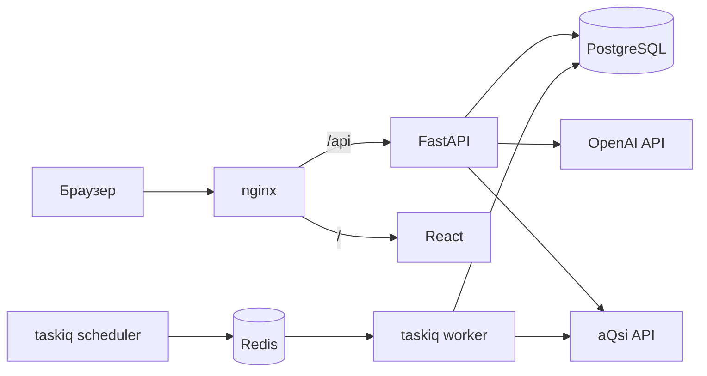

# Счетовод

Учётная система для небольшого розничного магазина: суммовой учёт товара и приёмка
накладных по фото.

Продавец фотографирует накладную, языковая модель переписывает её в структурированные
данные, программа сверяет арифметику и сопоставляет товары с каталогом, а человек
проверяет черновик и проводит его. Все движения товара и денег попадают в журнал, по
которому строятся отчёты.

## Возможности

- **Приёмка накладных** — из фото (несколько страниц) или JSON: поиск поставщика по ИНН,
  подбор товаров, розничная цена по наценке, подсветка расхождений в суммах.
- **Журнал операций** — продажи, списания, приход без накладной, переучёт, переоценка,
  касса. Ошибочные операции сторнируются, а не удаляются.
- **Расчёты с поставщиками** — частичная оплата накладных и задолженность на конец
  периода.
- **Заказы поставщикам** — корзина и история подтверждённых заказов.
- **Отчёты** — сводка за период на экране, в XLSX и PDF.
- **Покупатели** — загруженность магазина и прогноз покупателей и выручки по чекам кассы
  aQsi.
- **Прибыль** — оценка прибыли по месяцам и редактируемые операционные расходы.

## Архитектура



| Слой | Технологии |
| --- | --- |
| Backend | Python 3.14, FastAPI, Pydantic, SQLAlchemy 2 (async), Alembic |
| Данные | PostgreSQL 18, Redis 8 |
| Фоновые задачи | taskiq |
| Frontend | React 19, TypeScript, Vite, без UI-библиотек |
| Окружение | Docker Compose, nginx |
| Качество | uv, Ruff, ty, pytest |

Ключевые решения:

- **Человек в контуре.** Распознавание создаёт только черновик. В учёт данные попадают
  после проверки и подтверждения.
- **Журнал только на добавление.** Исправление — это обратная запись, поэтому история
  остаётся полной.
- **Деньги в `Decimal`/`NUMERIC`.** Целостность данных обеспечивают ограничения
  PostgreSQL.
- **Слои внутри доменов.** Роут → сервис → репозиторий. Подробности — в
  [app/README.md](app/README.md).
- **Авторизация.** Пароли в Argon2, JWT в `HttpOnly`-куках с `SameSite=Strict`, открытой
  регистрации нет.

### Распознавание накладных

Работает через OpenAI Responses API, промпт лежит в
[`app/recognition/prompt.md`](app/recognition/prompt.md).

- Модель работает как дословный транскрибер: ничего не считает и не достраивает, поэтому
  нечитаемое поле остаётся пустым и не скрывает ошибку.
- Structured Outputs задают строгую форму ответа, значения дополнительно проверяет
  Pydantic.
- Инструмент `crop_image` позволяет модели запросить увеличенный фрагмент страницы, если
  текст мелкий, размытый или повёрнутый.
- Фото, ответы, фрагменты и расход токенов сохраняются, чтобы можно было разобрать любое
  распознавание.

## Быстрый старт

Нужны Docker с Compose и Make.

```sh
git clone https://github.com/vaakesh/schetovod.git && cd schetovod
cp .env.example .env
```

В `.env` задайте `JWT_SECRET`, сгенерировав его командой `openssl rand -hex 32`. Затем:

```sh
make up                  # сборка и запуск, миграции применяются автоматически
make user login=admin    # создание пользователя, команда спросит пароль
```

Приложение откроется на http://localhost:11300. Правки в `app/` и `frontend/src/`
подхватываются без перезапуска, кроме кода воркера и планировщика. После новых
зависимостей или миграций снова выполните `make up`. Остановка с сохранением данных —
`make down`.

## Настройка

Переменные задаются в `.env`:

| Переменная | Назначение |
| --- | --- |
| `JWT_SECRET` | Обязательна, минимум 32 символа |
| `POSTGRES_PASSWORD` | Пароль базы |
| `POSTGRES_PORT` | Порт базы на хосте, смените, если 5432 занят |
| `OPENAI_API_TOKEN` | Необязательна, без неё отключено только распознавание фото |
| `AQSI_API_INTEGRATION` | Необязательна, без неё не загружаются чеки и смены из aQsi |
| `AUTH_COOKIE_SECURE` | Поставьте `0` для обычного HTTP, иначе браузер не сохранит куки |

## Разработка

Проверки backend запускаются из `app/`, нужны Python 3.14 и uv. Тесты идут без базы и
внешних сервисов:

```sh
uv sync
uv run ruff check .
uv run ruff format --check .
uv run ty check
uv run pytest
```

Проверка frontend запускается из `frontend/`:

```sh
npm ci
npm run build
```

Устройство backend описано в [app/README.md](app/README.md).
